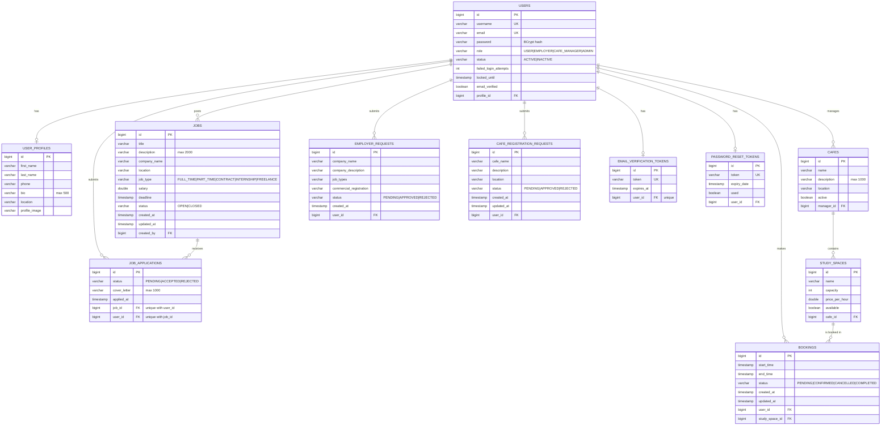

# WASLAH — Jobs & Study-Space Booking API

A secure Spring Boot REST API that connects people to **work opportunities** and **places to work**: users can browse and apply for jobs posted by verified employers, and book desks or rooms in partner cafés.

> Built for **Project 2 — Build a Secure Spring Boot REST API** (Unit 2 Backend Application).

---

## Table of Contents

1. [Project Information](#project-information)
2. [Technologies](#technologies)
3. [Architecture](#architecture)
4. [General Approach](#general-approach)
5. [Business Rules](#business-rules)
6. [User Stories](#user-stories)
7. [ERD](#erd)
8. [Planning](#planning)
9. [API Documentation](#api-documentation)
10. [Installation](#installation)
11. [Testing](#testing)
12. [Unsolved Problems](#unsolved-problems)
13. [Major Challenges](#major-challenges)
14. [Future Improvements](#future-improvements)
15. [Credits & External Resources](#credits--external-resources)

---

## Project Information

**Title:** WASLAH (وصلة) API

**Description:** WASLAH is a backend platform with two connected halves:

- **Jobs** — employers publish job postings; job seekers browse them and apply.
- **Study-space booking** — café managers list their cafés and study spaces (quiet desks, group rooms, meeting rooms); users book a space for a time slot, and the café manager confirms or rejects the booking.

**Purpose:** Many students, freelancers and job seekers in Bahrain need both a place to work and a route to employment. WASLAH puts both in one system, with role-based access so each type of user only sees and does what they should.

**Users / roles**

| Role | What they can do |
|---|---|
| `USER` | Register, manage own profile, browse/apply for jobs, book study spaces, request upgrade to Employer or Café Manager |
| `EMPLOYER` | Create, update and close own job postings; review and accept/reject applications to own jobs |
| `CAFE_MANAGER` | Manage own cafés (create, update, deactivate/activate); confirm or reject bookings for own cafés |
| `ADMIN` | Deactivate users; approve or reject Employer and Café Manager requests |

**Main features**

- Registration with **email verification** (mock email — link printed to the console)
- **JWT login** (24-hour tokens), BCrypt password hashing, temporary account lock after repeated failed logins
- Forgot-password / reset-password with expiring, single-use tokens, and change-password for logged-in users
- **Role-based authorization** enforced with Spring Security (`@PreAuthorize` + service-layer ownership checks)
- Admin-approved **role upgrade workflows** (User → Employer, User → Café Manager)
- **Booking workflow** with availability checks, overlap (double-booking) prevention, and status transitions
- **Job workflow**: posting, closing, applying (one application per user per job), accept/reject
- **Soft delete** for users (`INACTIVE`), cafés (`active = false`) and jobs (`CLOSED`)
- **Rate limiting** on login, registration and password-recovery endpoints
- Consistent JSON **error responses** via a global exception handler
- **Swagger / OpenAPI** interactive documentation
- **Database seeding** of a demo café manager, two cafés and five study spaces on first start

---

## Technologies

| Technology | Purpose |
|---|---|
| Java 17 | Language |
| Spring Boot 4.1.1 | Application framework, embedded Tomcat |
| Spring Web MVC | REST controllers |
| Spring Data JPA / Hibernate | ORM and repositories |
| Spring Security | Authentication, authorization, BCrypt hashing |
| JWT (jjwt 0.11.5) | Stateless token authentication |
| PostgreSQL | Relational database |
| Bean Validation (Jakarta) | Server-side request validation |
| springdoc-openapi 3.0.0 (Swagger UI) | Interactive API documentation |
| Lombok | Boilerplate reduction |
| JUnit 5 / Spring Boot Test | Unit tests |
| Maven (wrapper included) | Build tool |
| Git / GitHub | Version control |

---

## Architecture

WASLAH follows a classic **layered architecture**. Each layer has one responsibility and only talks to the layer beneath it:

```
Client (Postman / Swagger UI)
        │  HTTP + JWT
        ▼
Security filter chain  ── JwtAuthenticationFilter, RateLimitingInterceptor
        ▼
Controller   ── HTTP concerns only: routing, @Valid, status codes
        ▼
Service      ── business rules, ownership checks, state transitions
        ▼
Repository   ── Spring Data JPA queries
        ▼
PostgreSQL
```

### Package structure

```
src/main/java/com/ga/waslah
├── config/        DataLoader (seed data), OpenApiConfig (Swagger + JWT scheme)
├── controller/    REST controllers (Auth, User, Profile, Job, JobApplication, Cafe,
│                  StudySpace, Booking, CafeManagerBooking, EmployerRequest,
│                  CafeRegistration, Admin…)
├── dto/           Request/response objects — entities are never exposed directly
├── exception/     Custom exceptions + GlobalExceptionHandler + ErrorResponse
├── model/         JPA entities and status/role enums
├── repository/    Spring Data JPA repositories
├── security/      SecurityConfig, JwtService, JwtAuthenticationFilter,
│                  MyUserDetails(Service), RateLimitingInterceptor, WebConfig
└── service/       Business logic (+ MockEmailService)
```

### Major components

- **`SecurityConfig`** — stateless JWT security. Only registration, login, email verification, password recovery and Swagger routes are public; **every other route requires a valid JWT**. 401 and 403 responses from the security layer use the same JSON shape as application errors.
- **`JwtService` / `JwtAuthenticationFilter`** — issue and validate HS256 tokens (24-hour expiry); invalid or expired tokens are rejected.
- **`RateLimitingInterceptor`** — per-IP, per-endpoint request limiter (see [Business Rules](#business-rules)).
- **`GlobalExceptionHandler`** — maps exceptions to the standard error body and hides internal details (no stack traces).
- **`DataLoader`** — seeds demo data on startup if it does not already exist.
- **DTOs** — requests are validated with Bean Validation; responses never include password hashes or other internal fields.

### Error response format

Every error uses the same structure:

```json
{
  "timestamp": "2026-10-15T10:30:00",
  "status": 404,
  "error": "RESOURCE_NOT_FOUND",
  "message": "Booking not found",
  "path": "/api/bookings/42"
}
```

Status codes used: `200`, `201`, `204`, `400`, `401`, `403`, `404`, `409`, `429`, `500`.

---

## General Approach

**How I approached the project.** I started from the problem — people need both work and a place to work — and wrote user stories for each type of user before touching code. From those I derived the roles, the data model and the business rules, then built the project in layers following the [project plan](./PROJECT%20PLAN.md): database models and repositories first, then services and core APIs, then authentication and role-based authorization, account security (password recovery, rate limiting), the booking module, and finally testing and validation.

**How I structured the application.** Controllers are deliberately thin: they accept a validated DTO, call a service and return a status code. All business decisions — "is this space free?", "does this booking belong to this user?", "can this job still accept applications?" — live in the service layer, which makes them easy to unit test. Authorization happens at two levels: coarse role checks at the route (`@PreAuthorize`) and fine-grained ownership checks inside services (a café manager can only manage bookings for *their* café; an employer can only edit *their* jobs).

**How the major features were implemented.**

- *Authentication:* register → mock verification email → verify → login → JWT. Login rejects unverified and inactive accounts, and locks an account for one minute after three wrong passwords.
- *Booking:* a booking starts `PENDING`; while `PENDING` or `CONFIRMED` it blocks its time slot, so an overlapping request is refused. Cancelling frees the slot. The café manager confirms or rejects pending bookings.
- *Role upgrades:* public registration always creates a `USER`. Becoming an `EMPLOYER` or `CAFE_MANAGER` requires submitting a request that an `ADMIN` must approve — so privileged roles can never be self-assigned.
- *Soft delete:* "deleting" a user sets `status = INACTIVE`, which blocks login while preserving their bookings, applications and history.

---

## Business Rules

| # | Rule | Enforced in |
|---|---|---|
| 1 | An unverified user cannot log in | `AuthController` |
| 2 | An inactive (deactivated) user cannot log in | `AuthController` |
| 3 | Three failed logins lock the account for 1 minute | `UserService` |
| 4 | Login / register: 5 requests per minute per IP; forgot / reset password: 3 per minute per IP (HTTP `429`) | `RateLimitingInterceptor` |
| 5 | Registration always creates a `USER`; usernames and emails must be unique (`409`) | `UserService` |
| 6 | Email-verification tokens expire after 24 hours; password-reset tokens expire after 15 minutes and can be used once | token services |
| 7 | Changing a password requires the current password, and the new one must differ | `UserService` |
| 8 | A booking's end must be after its start, and both must be in the future | `BookingRequest`, `BookingService` |
| 9 | A study space cannot be booked if it is unavailable or overlaps an existing `PENDING`/`CONFIRMED` booking | `BookingService` |
| 10 | Users can only view or cancel **their own** bookings; completed or already-cancelled bookings cannot be cancelled | `BookingService` |
| 11 | A café manager can only confirm/reject **pending** bookings for **their own** cafés | `CafeManagerBookingService` |
| 12 | Only the owning café manager can update, deactivate or activate a café | `CafeService` |
| 13 | Only employers can post jobs, and only the job's owner can edit or close it; a closed job cannot be edited | `JobService` |
| 14 | Users can only apply to `OPEN` jobs before the deadline, and only once per job (`409`) | `JobApplicationService` |
| 15 | Only the job's employer can accept/reject applications, and only `PENDING` applications can be decided | `JobApplicationService` |
| 16 | An employer or café-manager upgrade needs admin approval; a user can't have more than one open employer request | `EmployerRequestService`, `CafeRegistrationService` |
| 17 | Only an admin can deactivate users; an already-inactive user returns `409` | `UserService` |

---

## User Stories

User stories are documented in [`USER STORY.md`](./USER%20STORY.md).

Trello board: **[add Trello user-stories board link here]**

---

## ERD

Entity Relationship Diagram (generated from the JPA entities):



ERD image / dbdiagram.io link: **[add link or `docs/erd.png` here]**

---

## Planning

The project was divided into daily deliverables (planning, database, core APIs, authentication, account security, booking module, testing). The full plan is in [`PROJECT PLAN.md`](./PROJECT%20PLAN.md).

Trello planning board (deliverables, timeline, scope, progress): **[add Trello planning board link here]**

---

## API Documentation

### Interactive documentation (Swagger / OpenAPI)

Once the application is running:

| | URL |
|---|---|
| Swagger UI | <http://localhost:8080/swagger-ui/index.html> |
| OpenAPI JSON | <http://localhost:8080/v3/api-docs> |

To call protected endpoints from Swagger UI: `POST /auth/login` → copy the `token` from the response → click **Authorize** → paste the token → run requests.

### Authentication

Protected endpoints need the JWT in the `Authorization` header:

```http
Authorization: Bearer <JWT_TOKEN>
```

Missing, invalid or expired tokens return `401`. A valid token without the required role (or accessing someone else's resource) returns `403`.

### Endpoint reference

**Access levels:** *Public* = no token · *Private* = any valid token · *User / Employer / Café Manager / Admin* = valid token **and** that role. "(owner)" = the resource must also belong to the caller.

#### Authentication & account

| Request | URL | Functionality | Access |
|---|---|---|---|
| POST | `/auth/register` | Register a new user (rate limited) | Public |
| GET | `/auth/verify-email?token=` | Verify email address | Public |
| POST | `/auth/login` | Log in, receive JWT (rate limited) | Public |
| POST | `/auth/forgot-password` | Request a password-reset token (rate limited) | Public |
| POST | `/auth/reset-password` | Reset password using a token (rate limited) | Public |
| GET | `/auth/test` | Check that a JWT is accepted | Private |
| PUT | `/api/users/change-password` | Change own password | Private |
| DELETE | `/api/users/{id}` | Deactivate a user (soft delete → `INACTIVE`) | Admin |
| DELETE | `/api/admin/users/{id}` | Deactivate a user (same action, admin route) | Admin |

#### Profile

| Request | URL | Functionality | Access |
|---|---|---|---|
| GET | `/api/profile` | Get own profile | Private |
| PUT | `/api/profile` | Update own profile | Private |
| PUT | `/api/profile/image` | Set profile image (multipart field `image`) | Private |

#### Jobs & applications

| Request | URL | Functionality | Access |
|---|---|---|---|
| GET | `/api/jobs` | List jobs | Private |
| GET | `/api/jobs/{id}` | Get a job | Private |
| POST | `/api/jobs` | Create a job | Employer |
| PUT | `/api/jobs/{id}` | Update a job | Employer (owner) |
| DELETE | `/api/jobs/{id}` | Close a job (soft delete → `CLOSED`) | Employer (owner) |
| POST | `/api/applications/jobs/{jobId}` | Apply to a job | User |
| GET | `/api/applications/my` | List own applications | Private |
| GET | `/api/applications/jobs/{jobId}` | List applications for a job | Employer (owner) |
| PUT | `/api/applications/{applicationId}/status?status=ACCEPTED\|REJECTED` | Accept or reject an application | Employer (owner) |

#### Role-upgrade requests

| Request | URL | Functionality | Access |
|---|---|---|---|
| POST | `/api/employer-requests` | Request to become an Employer | User |
| GET | `/api/employer-requests/my` | View own employer request | Private |
| GET | `/api/admin/employer-requests` | List pending employer requests | Admin |
| PUT | `/api/admin/employer-requests/{id}/approve` | Approve (user becomes `EMPLOYER`) | Admin |
| PUT | `/api/admin/employer-requests/{id}/reject` | Reject | Admin |
| POST | `/api/cafe-requests` | Request to register a café / become a Café Manager | User |
| GET | `/api/cafe-requests/my` | List own café requests | Private |
| GET | `/api/cafe-requests/pending` | List pending café requests | Admin |
| PUT | `/api/cafe-requests/{id}/decision` | Approve or reject (`{"decision":"APPROVED"}`) | Admin |

#### Cafés, study spaces & bookings

| Request | URL | Functionality | Access |
|---|---|---|---|
| GET | `/api/cafes` | List cafés | Private |
| GET | `/api/cafes/{id}` | Get a café | Private |
| GET | `/api/cafes/my` | List own cafés | Café Manager |
| POST | `/api/cafes` | Create a café | Café Manager |
| PUT | `/api/cafes/{id}` | Update a café | Café Manager (owner) |
| DELETE | `/api/cafes/{id}` | Deactivate a café (soft delete) | Café Manager (owner) |
| PUT | `/api/cafes/{id}/activate` | Re-activate a café | Café Manager (owner) |
| GET | `/api/study-spaces` | List available study spaces in active cafés | Private |
| POST | `/api/bookings` | Create a booking (`PENDING`) | Private |
| GET | `/api/bookings` | List own bookings | Private |
| GET | `/api/bookings/{id}` | Get own booking | Private (owner) |
| PUT | `/api/bookings/{id}/cancel` | Cancel own booking | Private (owner) |
| GET | `/api/manager/bookings` | List bookings for own cafés | Café Manager |
| PUT | `/api/manager/bookings/{id}/confirm` | Confirm a pending booking | Café Manager (owner) |
| PUT | `/api/manager/bookings/{id}/cancel` | Reject a pending booking | Café Manager (owner) |

### Example requests

**Register**
```http
POST /auth/register
Content-Type: application/json

{ "username": "sara", "email": "sara@example.com", "password": "Passw0rd!" }
```
Validation: username 3–30 characters, valid email, password at least 8 characters.

**Login**
```http
POST /auth/login
Content-Type: application/json

{ "username": "sara", "password": "Passw0rd!" }
```
```json
{ "token": "eyJhbGciOiJIUzI1NiJ9..." }
```

**Create a booking**
```http
POST /api/bookings
Authorization: Bearer <JWT_TOKEN>
Content-Type: application/json

{ "studySpaceId": 1, "startTime": "2026-12-01T14:00:00", "endTime": "2026-12-01T15:00:00" }
```
A second request overlapping that slot is refused with `400` (`"This study space is already booked for the selected time"`).

**Reset password** (take the token from the console output of `/auth/forgot-password`)
```http
POST /auth/reset-password
Content-Type: application/json

{ "token": "<token-from-console>", "newPassword": "NewPassw0rd!" }
```

---

## Installation

### Prerequisites

- **Java 17+** (JDK)
- **PostgreSQL** running locally (default port 5432)
- **Git**
- Maven is **not** required — the included wrapper (`mvnw` / `mvnw.cmd`) downloads it.

### 1. Clone the repository

```bash
git clone <your-repository-url>
cd <repository-folder>
```

### 2. Create the database

```sql
CREATE DATABASE waslah;
```

Tables are created automatically on first start (`spring.jpa.hibernate.ddl-auto=update`).

### 3. Configure the application

Make sure `src/main/resources/application.properties` exists with the content below. It contains **no secrets** — credentials are read from environment variables.

```properties
spring.application.name=waslah
server.port=8080

spring.datasource.url=jdbc:postgresql://localhost:5432/waslah
spring.datasource.username=postgres
spring.datasource.password=${DB_PASSWORD}
spring.datasource.driver-class-name=org.postgresql.Driver

spring.jpa.hibernate.ddl-auto=update
spring.jpa.show-sql=true
spring.jpa.properties.hibernate.format_sql=true

jwt.secret=${JWT_SECRET}
```

If your PostgreSQL user or port differs, change `spring.datasource.url` / `spring.datasource.username`.

### 4. Set environment variables

| Variable | Description |
|---|---|
| `DB_PASSWORD` | Password of the PostgreSQL user |
| `JWT_SECRET` | Secret used to sign JWTs — **at least 32 characters** |

macOS / Linux:
```bash
export DB_PASSWORD='your-db-password'
export JWT_SECRET='replace-with-a-long-random-string-of-32+chars'
```

Windows (PowerShell):
```powershell
$env:DB_PASSWORD = "your-db-password"
$env:JWT_SECRET  = "replace-with-a-long-random-string-of-32+chars"
```

Never commit real secrets to GitHub.

### 5. Seed the database

Seeding is automatic: on startup `DataLoader` creates the following if they don't exist.

| Seeded data | Details |
|---|---|
| Café manager account | username `cafe.manager`, password `Cafe@12345` (demo only) |
| Café 1 | *Bahrain Study Cafe* (Manama) — Quiet Desk 1, Quiet Desk 2, Group Room |
| Café 2 | *WASLAH Workspace Cafe* (Seef) — Individual Desk, Meeting Room |

**Creating an admin (one-time).** No admin is seeded, so promote an account yourself after registering and verifying it (see step 7):

```sql
UPDATE users SET role = 'ADMIN' WHERE username = 'your-username';
```

Then log in again to use admin endpoints.

### 6. Start the application

```bash
./mvnw spring-boot:run        # macOS / Linux
mvnw.cmd spring-boot:run      # Windows
```

The API starts on **http://localhost:8080** (embedded Tomcat).

### 7. Access the API

Try the full sign-up flow:

1. `POST /auth/register` with a username, email and password.
2. **Verify your email.** Emails are mocked: look in the application console for the *WASLAH EMAIL VERIFICATION* block and open the printed link (`GET /auth/verify-email?token=...`).
3. `POST /auth/login` → copy the JWT.
4. Call protected endpoints with `Authorization: Bearer <JWT>`.

For a quick demo without registering, log in as `cafe.manager` / `Cafe@12345` and call `GET /api/manager/bookings`.

### 8. Access Swagger / OpenAPI

Open **http://localhost:8080/swagger-ui/index.html**.

---

## Testing

```bash
./mvnw test
```

Unit tests cover the most important logic:

| Area | Test class |
|---|---|
| Booking creation, availability & cancellation | `BookingServiceTest` |
| Job posting | `JobServiceTest` |
| Employer-request workflow | `EmployerRequestServiceTest` |
| User registration / account logic | `UserServiceTest` |
| Email verification | `EmailVerificationServiceTest` |
| Rate limiting | `RateLimitingInterceptorTest` |
| JWT validation filter | `JwtAuthenticationFilterTest` |
| User details / roles | `MyUserDetailsTest` |

`WaslahApplicationTests` (`contextLoads`) starts the full application, so it needs PostgreSQL running and `DB_PASSWORD` / `JWT_SECRET` set. To run only the unit tests: `./mvnw -Dtest='!WaslahApplicationTests' test`.

---

## Unsolved Problems

Known gaps and limitations in the current version:

- **Real-time notifications are not implemented.** There is no WebSocket or Server-Sent Events support yet, so clients are not pushed booking updates.
- **Logging and audit trail are missing.** Important events (logins, bookings, admin actions) are not written to an application log or an audit table.
- **No pagination, sorting or search/filtering.** List endpoints return full lists and accept no query parameters (e.g. no `?status=` or `?page=`).
- **Profile-image upload is minimal.** `PUT /api/profile/image` records only the uploaded file's *name*; the file itself is not stored, and type/size are not validated. Multi-file upload is not supported.
- **No Spring Profiles.** A single `application.properties` is used; there are no separate development/test profiles or in-memory test database.
- **Emails are mocked.** Verification and reset messages are printed to the console. The reset email prints a `GET` link, but password reset is a `POST` with a JSON body — use the token from the console.
- **Double-booking check is not concurrency-safe.** The overlap check and the insert are separate steps, so two simultaneous requests for the same slot could both succeed. A database constraint or locking would close this gap.
- **`COMPLETED` booking status is never set.** No endpoint or scheduled job moves a confirmed booking to `COMPLETED`.
- **No seeded admin.** An admin must be created with the SQL in [Installation](#5-seed-the-database).
- **Swagger detail is limited.** Endpoints are auto-discovered; most do not yet have descriptions, request/response examples or per-endpoint status-code annotations.
- **Rate limiting is in-memory.** Counters are per application instance and reset on restart.
- **Duplicate admin route.** User deactivation is available on both `/api/users/{id}` and `/api/admin/users/{id}`.
- **Partial audit fields.** `createdAt`/`updatedAt` exist on bookings, jobs and café requests only; `createdBy`/`updatedBy` are not tracked.

---

## Major Challenges

**Preventing double-booking.** A slot must be refused if it overlaps *any* active booking, not just one with the identical start time. This is solved with an overlap query — an existing booking conflicts when `existing.start < requested.end` **and** `existing.end > requested.start` — checked against `PENDING` and `CONFIRMED` bookings. Cancelled bookings no longer match, so cancelling releases the slot automatically.

**Stopping privilege escalation.** If registration accepted a role, anyone could make themselves an admin. Registration therefore always creates a `USER`, and `EMPLOYER` / `CAFE_MANAGER` can only be granted when an admin approves a request. Authorization is checked twice: by role at the route, and by ownership inside the service (so one café manager cannot touch another's bookings).

**Protecting login from brute force.** Two layers were combined: a per-IP rate limiter on the public auth endpoints (HTTP `429`), and a per-account lock after three failed passwords. Login also refuses unverified and inactive accounts before checking the password.

**Consistent errors from every layer.** Errors raised inside Spring Security (missing token, forbidden) happen before a request reaches a controller, so `GlobalExceptionHandler` cannot catch them. A custom authentication entry point and access-denied handler return the same JSON structure so clients see one error format everywhere.

---

## Future Improvements

- Implement **WebSocket/SSE** notifications (booking confirmed / cancelled / status changed)
- Add **logging** (SLF4J) and a persistent **audit log** of administrative and booking actions
- Add **pagination, sorting and filtering** (e.g. cafés by location, bookings by status, jobs by type)
- Real **file storage** for profile pictures with type and size validation
- Add **Spring Profiles** (`dev`, `test`) with an H2/Testcontainers test database
- Send **real emails** (SMTP provider) and make the reset link point to a working page
- Make booking creation **atomic** (database exclusion constraint or pessimistic lock) and add a scheduler to mark finished bookings `COMPLETED`
- Seed an admin and sample users, jobs and bookings for easier demos
- Complete **Swagger annotations** (descriptions, examples, security requirement on protected routes)
- Add refresh tokens and token revocation; avoid revealing whether a username/email exists on login and forgot-password
- Move demo credentials out of source code; add integration tests for role-based authorization
- Add a **frontend** and an admin dashboard

---

## Credits & External Resources

| Resource | URL | Used for |
|---|---|---|
| Spring Boot Documentation | https://docs.spring.io/spring-boot/ | Project setup, configuration, JPA and web MVC |
| Spring Security Documentation | https://docs.spring.io/spring-security/reference/ | Security filter chain, method security, BCrypt |
| jjwt (JSON Web Token for Java) | https://github.com/jwtk/jjwt | Generating and validating JWTs |
| springdoc-openapi | https://springdoc.org/ | Swagger UI / OpenAPI generation |
| PostgreSQL Documentation | https://www.postgresql.org/docs/ | Database setup and SQL |
| Project Lombok | https://projectlombok.org/ | Reducing boilerplate in entities and services |
| Claude (Anthropic) | https://claude.ai | Drafting and structuring this README from the project source and requirements |
| *[add any tutorials, Stack Overflow answers, classmates or instructors who helped]* | | |
